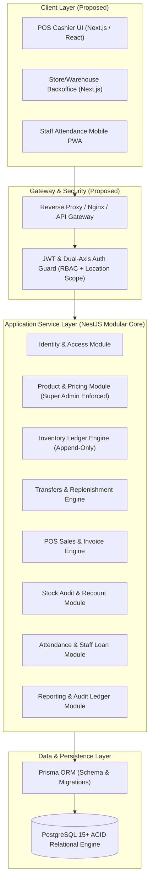
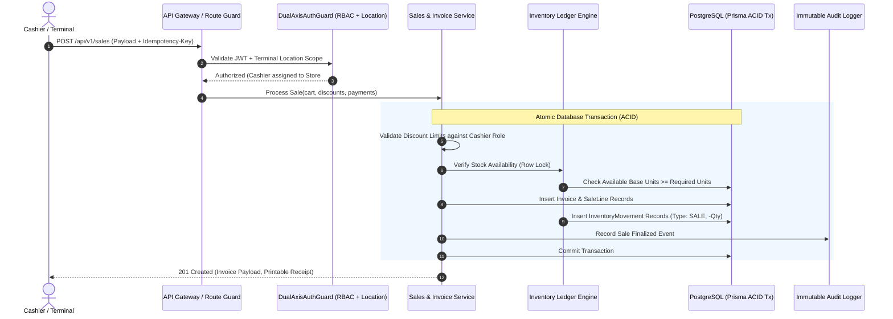
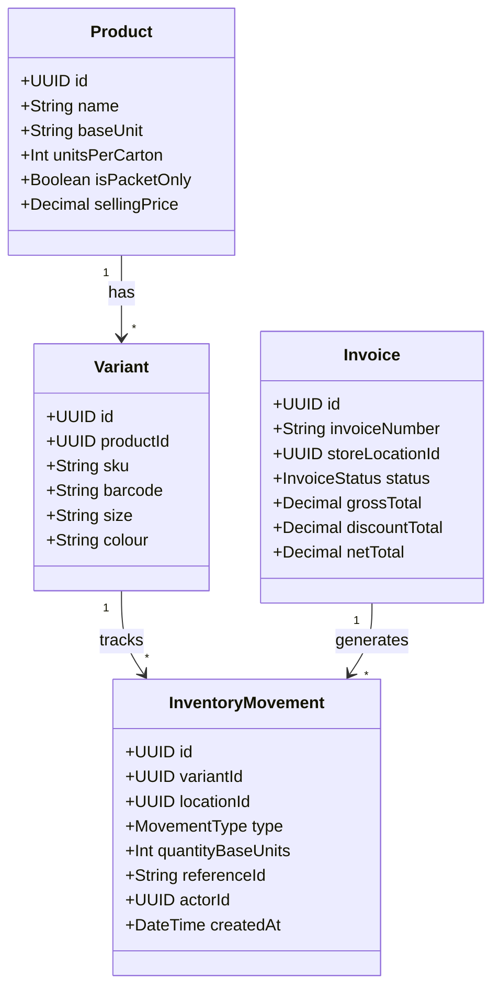

# System Architecture & Technical Design: Premium Retail POS

> Comprehensive system design, module boundaries, data integrity invariants, architectural decision records (ADRs), and security controls for the Premium Retail POS system.

---

## 1. System Overview

### 1.1 Current Repository Implementation State
- **Status**: Greenfield / Inception Phase.
- **Repository Contents**: Core architectural and operational documentation ([README.md](file:///c:/Users/shibi/Documents/dev/POS/README.md), [ROADMAP.md](file:///c:/Users/shibi/Documents/dev/POS/ROADMAP.md), [ARCHITECTURE.md](file:///c:/Users/shibi/Documents/dev/POS/ARCHITECTURE.md), [CHANGELOG.md](file:///c:/Users/shibi/Documents/dev/POS/CHANGELOG.md)).
- **Implemented Services**: None currently running or committed.

### 1.2 Proposed Technical Architecture
In accordance with Section 21 of the specification document, the proposed enterprise architecture adopts a modular multi-tier structure designed for transactional consistency, horizontal scalability, and strict security isolation:



- **Frontend Tier**: React / Next.js web application providing optimized interfaces for high-throughput barcode cashier billing, warehouse stock dispatching, manager approvals, and mobile attendance.
- **Backend Tier**: NestJS application framework (TypeScript) structured into discrete domain modules. Every mutation runs inside strict transactional boundaries.
- **Persistence Tier**: PostgreSQL relational database with Prisma ORM, utilizing foreign key constraints, unique partial indexes, check constraints, and row-level locking for inventory integrity.

---

## 2. Directory Layout: Actual vs. Proposed

### 2.1 Actual Directory Structure
The repository root currently consists exclusively of the baseline documentation suite:
```text
POS/
├── ARCHITECTURE.md     # System design, data integrity invariants, and ADRs (this file)
├── CHANGELOG.md        # Chronological version notes
├── README.md           # Project overview and developer onboarding
└── ROADMAP.md          # Implementation phases and open decisions tracker
```

### 2.2 Proposed Directory Structure (Phase 1 Target)
The planned monorepo/modular layout organizes domain logic into clean vertical slices:
```text
POS/
├── apps/
│   ├── web/                           # Next.js Frontend
│   │   ├── src/
│   │   │   ├── app/                   # App router pages (pos, warehouse, admin)
│   │   │   ├── components/            # UI components (thermal print layouts, tables)
│   │   │   ├── hooks/                 # State management & hardware scanner hooks
│   │   │   └── lib/                   # API clients and offline synchronization
│   └── api/                           # NestJS Backend API
│       ├── src/
│       │   ├── common/                # Shared decorators, guards, filters, interceptors
│       │   │   ├── decorators/        # @Roles(), @LocationScoped(), @CurrentUser()
│       │   │   ├── guards/            # DualAxisAuthGuard, LocationScopeGuard
│       │   │   └── interceptors/      # IdempotencyInterceptor, AuditLoggingInterceptor
│       │   ├── modules/               # Vertical Domain Slices
│       │   │   ├── auth/              # Authentication & JWT tokens
│       │   │   ├── location/          # Main Warehouse, Sub-Warehouses, Stores
│       │   │   ├── catalogue/         # Products, variants, units, pricing
│       │   │   ├── inventory/         # Movement ledger, stock balances, conversions
│       │   │   ├── receiving/         # Supplier stock-in
│       │   │   ├── transfer/          # Inter-location transfers & replenishment
│       │   │   ├── sales/             # POS checkout, cart deletions, cancellations
│       │   │   ├── audit/             # Weekly physical counts, recounts, approvals
│       │   │   ├── attendance/        # QR/GPS mobile check-in/out
│       │   │   ├── loans/             # Employee advances, repayments, ledger
│       │   │   └── reports/           # Financial & stock ledger reconciliation
│       │   └── prisma/                # Prisma schema, migrations, seed configurations
├── packages/                          # Shared DTOs and TypeScript types
├── .env.example
├── docker-compose.yml                 # Local PostgreSQL and Redis environment
├── package.json
└── tsconfig.json
```

---

## 3. Data Flow Architecture

A typical mutating user transaction (e.g., POS Sale Finalization) traverses the system through five distinct layers:



1. **Client Request**: The frontend transmits an HTTPS request including bearer credentials, terminal location identifier, and a client-generated UUID `Idempotency-Key`.
2. **Dual-Axis Authorization**: `DualAxisAuthGuard` validates that the user token is active, matches required role capabilities, and possesses explicit authority to operate on the target location.
3. **Domain Execution within ACID Transaction**: The domain service begins a PostgreSQL transaction (`prisma.$transaction`). It executes row-level concurrency locks (`SELECT ... FOR UPDATE`), validates stock balances in canonical base units, checks cashier discount limits, and records sale lines.
4. **Append-Only Ledger Entry**: Dedicated `InventoryMovement` entries are inserted with negative quantities tied to the newly generated invoice ID. Stock balances are never overwritten in-place.
5. **Audit Logging & Response**: High-impact actions trigger an immutable audit event recording actor, timestamp, location, and parameters before returning the finalized invoice.

---

## 4. Module Boundaries & Responsibilities

The system is partitioned into twelve modular domains. Each module enforces strict boundary encapsulation:

| Module Name | Core Responsibilities | Owned Business Invariants & Rules |
| :--- | :--- | :--- |
| **1. Identity & Access** | User credentials, JWT issuance, session termination, password resets, role management. | Passwords hashed with bcrypt; deactivated users rejected immediately; user-location bindings enforced. |
| **2. Organization & Locations** | Company settings, warehouse and store records, manager assignments. | Tiered hierarchy (`Main Warehouse` &rarr; `Sub-Warehouse` &rarr; `Retail Store`); active history prevents hard deletion. |
| **3. Product Catalogue & Pricing** | Products, variants (size/colour), SKU/barcodes, unit conversion ratios, pricing. | **Super Admin only** may alter purchase/selling prices; price edits require logged reason; variants have distinct SKU identities. |
| **4. Inventory Ledger** | Canonical base unit stock tracking, stock state segregation, ledger reconciliation. | All stock changes create append-only ledger movements; stock balance is a pure function of historical movements; negative stock is permitted with prominent UI warnings and negative balance display (`OD-03`). |
| **5. Supplier Receiving** | Supplier stock-in recording, carton/loose packet receipt validation. | Stock posted only upon receipt confirmation; receipt creates `SUPPLIER_RECEIPT` movements. |
| **6. Transfers & Replenishment** | Auto-replenishment calculation, transfer lifecycle state machine, transit tracking. | In-transit stock cannot be sold at destination; cancelled transfers reversed via ledger; transfers support full cartons as well as opened cartons and loose packets across warehouses (`OD-01`). |
| **7. POS & Sales** | Terminal binding, cart management, checkout, receipt numbering, invoice creation. | Invoices are immutable once finalized; sale cancellations create balancing reversal movements; active bill removals generate audit logs; POS continues operating offline, caching sales locally with automatic sync once online (`OD-11`). |
| **8. Discounts & Approvals** | Operator discount limit enforcement, manager override approval tracking. | Super Admin uncapped; Admin, Manager, Cashier have configured percentage thresholds enforced at both line-item AND bill level; discount stacking prohibited (`OD-07`). |
| **9. Stock Audit & Recount** | Weekly audit sessions, physical counts, variance detection, recount approvals. | Conducted after closing hours; freezes location stock movements during active audit session (`OD-04`); physical counts never alter stock directly without manager approval. |
| **10. Attendance** | Mobile check-in/out, rotating QR codes, GPS geofencing, manager punch corrections. | Geofence verification against store coordinates; punches immutable to staff; manager corrections preserve original values and reason. |
| **11. Loans & Advances** | Disbursal records, repayment tracking, balance computations, payroll linkage. | $\text{Outstanding} = \text{Issued} - \text{Repayments}$; planned payroll deductions do not reduce balance until officially confirmed. |
| **12. Reports & Audit** | Ledger aggregation, sales summaries, stock discrepancy tracking, tamper-evident audit logs. | Reports strictly filter by caller location permissions; audit logs are immutable and permanent. |

---

## 5. Data Integrity & Critical Invariants

The specification mandates fourteen non-negotiable architectural invariants. Below is the technical requirement and implementation directive for each rule:



### Invariant 1: Canonical Base Unit per Product
- **Rule**: Every product defines one canonical base unit (e.g., packet, piece) for all internal calculations, movements, and ledger storage.
- **Implementation Status**: *Required implementation rule (Pending codebase implementation).*
- **Design Enforcement**: Database column `Product.baseUnit` (string/enum); all `InventoryMovement.quantityBaseUnits` must be integers in base units.

### Invariant 2: Configurable Carton-to-Packet Conversions
- **Rule**: Products sold or received in cartons must specify an individual conversion ratio (e.g., 1 carton = 10 packets). No global ratio is permitted.
- **Implementation Status**: *Required implementation rule (Pending codebase implementation).*
- **Design Enforcement**: `Product.unitsPerCarton` integer field. 3 cartons + 4 packets converts deterministically to $(3 \times 10) + 4 = 34$ base units.

### Invariant 3: Native Packet-Only Products
- **Rule**: Packet-only products do not define or require carton conversions.
- **Implementation Status**: *Required implementation rule (Pending codebase implementation).*
- **Design Enforcement**: `Product.isPacketOnly = true` allows `unitsPerCarton = null`. Carton operations are rejected at API DTO validation for these items.

### Invariant 4: Ledger-Driven Stock Movements
- **Rule**: Stock balances must never be overwritten via direct update queries (`UPDATE stock_balance SET qty = 100` is forbidden). Every stock modification requires a new movement row.
- **Implementation Status**: *Required implementation rule (Pending codebase implementation).*
- **Design Enforcement**: Stock balances are calculated as $\sum \text{quantityBaseUnits}$ from `InventoryMovement` or maintained via transactional append-only trigger/service tables.

### Invariant 5: In-Transit Stock Isolation
- **Rule**: Dispatched transfers must move stock into an `IN_TRANSIT` state and must not increment destination available stock until formal receipt confirmation.
- **Implementation Status**: *Required implementation rule (Pending codebase implementation).*
- **Design Enforcement**: Dispatched transfer creates a negative movement at source (`-qty`, `TRANSFER_DISPATCH`) and a positive movement into virtual transit location. Destination available stock remains unchanged until `TRANSFER_RECEIPT` is posted.

### Invariant 6: Replenishment Requests Do Not Move Stock
- **Rule**: Auto-suggested or manager-initiated replenishment requests are purely informational drafts. They do not reserve, allocate, or move stock.
- **Implementation Status**: *Required implementation rule (Pending codebase implementation).*
- **Design Enforcement**: `ReplenishmentRequest` entity has no direct relationship with `InventoryMovement`. Movements only occur when a formal `Transfer` is dispatched.

### Invariant 7: Physical Counts Do Not Alter Stock Until Approved
- **Rule**: Entering a physical count during an audit session cannot directly alter inventory balances.
- **Implementation Status**: *Required implementation rule (Pending codebase implementation).*
- **Design Enforcement**: Audit count entries remain in `AuditCountItem` records. Only upon explicit manager approval of the variance is an `InventoryMovement` of type `STOCK_ADJUSTMENT` generated.

### Invariant 8: Completed Sales and Invoices Must Never Be Silently Deleted
- **Rule**: Hard deletion (`DELETE FROM invoices`) is forbidden by schema and application logic.
- **Implementation Status**: *Required implementation rule (Pending codebase implementation).*
- **Design Enforcement**: SQL user permissions exclude `DELETE` on invoices; Prisma service exposes no delete methods; entity status transitions to `CANCELLED`.

### Invariant 9: Reversal-Driven Sale Cancellation
- **Rule**: Cancelling a completed sale preserves the original invoice intact and creates offsetting financial and inventory reversal records.
- **Implementation Status**: *Required implementation rule (Pending codebase implementation).*
- **Design Enforcement**: `Invoice.status` set to `CANCELLED`; a linked `SaleCancellation` record is created with manager reason; opposite positive movements (`+qty`, `SALE_CANCELLATION`) are posted to restore stock.

### Invariant 10: Super Admin-Exclusive Price Changes
- **Rule**: Only users holding the `SUPER_ADMIN` role may modify purchase or selling prices.
- **Implementation Status**: *Required implementation rule (Pending codebase implementation).*
- **Design Enforcement**: Backend guard `@Roles('SUPER_ADMIN')` on `/api/v1/products/:id/price`; creates an immutable `PriceChangeHistory` entry recording old/new prices, actor ID, timestamp, and reason.

### Invariant 11: Backend-Enforced Role & Location Scoping
- **Rule**: Every protected endpoint must validate user role capabilities and location boundaries on the server. UI-only hiding is strictly insufficient.
- **Implementation Status**: *Required implementation rule (Pending codebase implementation).*
- **Design Enforcement**: Global `DualAxisAuthGuard` intercepts every incoming request, verifying JWT claims against requested entity location IDs.

### Invariant 12: Confirmed Loan Repayments Only
- **Rule**: Outstanding loan balance equals amount issued minus confirmed repayments. Planned or pending payroll deductions must not reduce the balance prematurely.
- **Implementation Status**: *Required implementation rule (Pending codebase implementation).*
- **Design Enforcement**: Calculation $\text{Balance} = \text{AmountIssued} - \sum \text{ConfirmedRepayments}$. Unsettled/scheduled payroll deduction records are stored in a `PENDING` state and excluded from the calculation.

### Invariant 13: Distributed Idempotency on Mutating Actions
- **Rule**: Retried requests (due to network drops or cashier double-clicks) must never duplicate invoices, stock deductions, or loan payments.
- **Implementation Status**: *Required implementation rule (Pending codebase implementation).*
- **Design Enforcement**: Client passes `Idempotency-Key` header; backend caches response in Redis/DB using a unique constraint; duplicate requests return the cached original response.

### Invariant 14: Historical Price and Conversion Snapshotting
- **Rule**: Future price updates or conversion ratio adjustments must never alter the financial totals or stock deductions of past transactions.
- **Implementation Status**: *Required implementation rule (Pending codebase implementation).*
- **Design Enforcement**: `SaleLine` explicitly copies `unitPrice`, `discountAmount`, `enteredUnit`, and `conversionRatioUsed` at the moment of sale finalization.

---

## 6. Architecture Decision Records (ADRs)

### ADR-001: Relational Database & Transactional ACID Integrity
- **Status**: Proposed (Pending repository setup)
- **Context**: Retail inventory and financial transactions require strict atomicity, serializability, and foreign-key referential integrity to prevent stock corruption and overselling.
- **Decision**: Adopt PostgreSQL 15+ as the primary database with Prisma ORM for schema migrations and type-safe query generation.
- **Rationale**: Relational integrity constraints, robust ACID transactional semantics (`prisma.$transaction`), and native support for row-level locking (`SELECT FOR UPDATE`) prevent race conditions during high-volume checkout.
- **Consequences**: Requires structured migrations and containerized database management.

### ADR-002: Append-Only Immutable Inventory Movement Ledger
- **Status**: Proposed
- **Context**: In traditional POS systems, overwriting stock balance columns leads to unaccountable shrinkage, race conditions, and an inability to reconcile discrepancies.
- **Decision**: Implement an append-only `InventoryMovement` ledger. Direct updates to stock balances are prohibited.
- **Rationale**: Provides a 100% auditable trail of every stock modification (who, what, where, why, and linked transaction reference).
- **Consequences**: Balance lookups require aggregate queries or a cached balance table synchronized strictly via transactional write triggers.

### ADR-003: Canonical Base Unit Inventory Tracking
- **Status**: Proposed
- **Context**: Products are purchased and shipped in cartons but often sold in loose packets. Products also have varying carton capacities (e.g., 10 packets vs. 24 packets), while some items are packet-only.
- **Decision**: Every stock movement is normalized into an integer quantity of canonical base units at the database layer.
- **Rationale**: Eliminates floating-point conversion errors, prevents fractional stock drift, and simplifies reconciliation across warehouses and stores.
- **Consequences**: UI components must provide human-readable conversion formatters (e.g., "2 cartons + 7 packets").

### ADR-004: Dual-Axis Authorization (RBAC + Location Scope)
- **Status**: Proposed
- **Context**: Cashiers and store managers must be strictly restricted to their assigned outlet's inventory, whereas Central Managers and Admins require multi-location oversight, and Super Admin requires global authority.
- **Decision**: Enforce authorization along two orthogonal axes on the backend: Role Capabilities (`RolesGuard`) and Location Boundaries (`LocationScopeGuard`).
- **Rationale**: Prevents data leaks across store branches and prevents unauthorized discount or price tampering.
- **Consequences**: Every domain query and mutation must incorporate location scoping parameters verified from JWT claims.

### ADR-005: Non-Destructive Sales Lifecycle (Audit-Only Deletion & Reversals)
- **Status**: Proposed
- **Context**: Unauthorized removal of items from checkout carts and silent deletion of completed sales are primary vectors for retail cashier fraud.
- **Decision**: Active cart line deletions generate an immutable audit log entry. Completed sales cannot be deleted; they can only be transitioned to `CANCELLED` via an explicit reversal transaction.
- **Rationale**: Guarantees complete operational traceability for loss prevention audits.
- **Consequences**: Financial reporting must distinguish between gross sales, refunds, cancellations, and net revenue.

### ADR-006: Distributed Idempotency and Concurrency Protection
- **Status**: Proposed
- **Context**: Network latency, offline reconnection, or rapid cashier double-clicks can cause duplicate payment processing or duplicate stock deduction.
- **Decision**: Require client-generated `Idempotency-Key` headers on all mutating POST/PATCH requests (`/sales`, `/transfers`, `/receiving`, `/loans/repayments`).
- **Rationale**: Guarantees that duplicate requests execute exactly once at the database layer.
- **Consequences**: Backend requires an idempotency middleware storing key, status, and cached response payload.

### ADR-007: Operating Mode Strategy (Online-First with Offline POS Resilient Queueing & Sync)
- **Status**: Accepted (Confirmed `OD-11`)
- **Context**: Retail checkout counters require uninterrupted operation during internet outages, but distributed offline multi-terminal writes can produce stock drift and race conditions.
- **Decision**: Adopt an **Online-First architecture with local client-side offline resilience** for the POS terminal. When internet is unavailable, checkout remains operational; sales are signed with terminal-generated UUIDs and stored locally in encrypted IndexedDB/Service Worker storage. Once connectivity is restored, the client background worker replays queued sales using `Idempotency-Key` headers to post transactions without duplication.
- **Rationale**: Keeps cashier lines moving while preserving centralized inventory ledger integrity and eliminating manual paper billing during network failures.
- **Consequences**: Cashier UI must clearly display connection state (`Online` / `Offline - Queued (N)`), and reconciliation pipelines must handle transactions synced with past timestamps.

### ADR-008: Immutable Audit Logging for Sensitive and Administrative Actions
- **Status**: Proposed
- **Context**: Price adjustments, discount limit overrides, attendance corrections, and loan approvals require tamper-evident records for internal compliance.
- **Decision**: Implement an application-wide `AuditEvent` service that captures actor, action, target entity, timestamp, reason, and before/after values into an append-only table.
- **Rationale**: Protects business owners against internal collusion and unauthorized configuration changes.
- **Consequences**: Additional database storage and indexing on audit event tables.

### ADR-009: Negative Stock Policy (Warning Alert & Negative Balance Recording)
- **Status**: Accepted (Confirmed `OD-03`)
- **Context**: Physical retail stock may be physically present on the shelf while electronic supplier receipts or transfer confirmations lag behind. Hard-blocking sales at checkout turns away customers and creates operational friction.
- **Decision**: Allow sales to proceed beyond zero available stock; display a prominent warning banner on the cashier UI and record/display resulting inventory balances as negative values in the ledger.
- **Rationale**: Balances cashier operational agility with accounting transparency, allowing subsequent stock receipts to automatically reconcile the negative balance.
- **Consequences**: Inventory dashboards and reports must clearly flag negative stock exceptions for manager review and investigation.

### ADR-010: Location Freeze for Stock Audits During Closed Hours
- **Status**: Accepted (Confirmed `OD-04`)
- **Context**: Performing physical inventory audits while sales or transfers are active creates moving-target discrepancies and reconciliation complexity.
- **Decision**: Physical stock audits will take place exclusively after store closing hours. When an audit session is initiated, the system applies an active lock (freeze) on all sales and stock movement endpoints for that specific location until the audit is formally submitted or closed.
- **Rationale**: Guarantees static expected quantities during counting, eliminating concurrency races between cashiers and auditors.
- **Consequences**: Emergency checkout or transfer operations are prevented while an audit lock is active; location managers must formally conclude or abort the audit to lift the lock.

### ADR-011: Dual-Tier Discount Authorization & Anti-Stacking Policy
- **Status**: Accepted (Confirmed `OD-07`)
- **Context**: Operators could attempt to evade discount approval caps by dividing discounts across line items or applying cascading cart-level discounts.
- **Decision**: Enforce discount authorization caps at both the line-item level AND the overall bill total. Furthermore, discount stacking (combining multiple promotions or overriding item discounts on top of bill discounts) is strictly blocked unless verified by an authorized manager.
- **Rationale**: Protects retail margins and ensures complete transparency in cashier discount auditing.
- **Consequences**: Cart calculation engine must validate both line-by-line and aggregated totals against the cashier's authorized threshold before completing the sale.

---

## 7. Security Architecture

### 7.1 Authentication & Session Management
- **Passwords**: Hashed using `bcrypt` (work factor 12) or `argon2id`. Plaintext passwords are never logged or stored.
- **Tokens**: Stateless, cryptographically signed JSON Web Tokens (JWT) with short lifespans (e.g., 8 hours).
- **Session Revocation**: User deactivation flags immediately invalidate subsequent authentication attempts.

### 7.2 Authorization Matrix (Dual-Axis)
Backend enforcement operates across seven discrete roles:

| Role | Permitted Locations | Price Changes | Discount Authority | Stock Adjustment | Attendance Oversight |
| :--- | :--- | :--- | :--- | :--- | :--- |
| **Super Admin** | Global (All Locations) | **Yes (Exclusive)**| Uncapped | Full Approval | Full Global Access |
| **Admin** | Authorized Locations | No | Predefined Cap | Authorized Approval | Authorized Locations |
| **Central Manager** | Main Warehouse | No | Store Limits | Warehouse Approval | Main Warehouse |
| **Sub-Warehouse Mgr**| Assigned Sub-Warehouse | No | Store Limits | Sub-Warehouse Appr. | Assigned Warehouse |
| **Store Manager** | Assigned Retail Store | No | Manager Cap | Store Audit Appr. | Assigned Store Staff |
| **Cashier** | Assigned Retail Store | No | Cashier Cap (Over-limit needs Mgr)| No | Self Only |
| **Staff / Employee** | Assigned Workplace | No | No | No | Self Punch & Own Loans |

### 7.3 Data Privacy & Protection
- **Attendance Signals**: Geolocation coordinates collected during mobile check-in are retained strictly for verification validation and purged or aggregated according to retention policies.
- **Employee Financial Records**: Loan and advance balances are restricted to HR/Super Admin and the individual employee (self-service); hidden from general store staff.
- **Secrets Management**: Database credentials, encryption keys, and JWT secrets are injected exclusively via environment variables; never checked into source repositories.

---

## 8. Testing Strategy

The proposed testing pyramid ensures strict adherence to business rules, concurrency safety, and acceptance criteria:

```text
               / \
              /   \
             / UAT \          User Acceptance Testing (Real workflows)
            /-------\
           /  E2E    \        End-to-End Tests (Cypress / Playwright)
          /-----------\
         / Integration \      API & DB Transaction Tests (Supertest, Testcontainers)
        /---------------\
       /   Unit Tests    \    Pure Business Logic (Jest / Vitest)
      /-------------------\
```

### 8.1 Unit Tests (Target: > 90% Domain Coverage)
- **Unit Conversions**: Mathematical accuracy of carton-to-packet and packet-to-carton transformations, mixed-unit formatting, and packet-only constraints.
- **Discount Calculations**: Verification that discounts adhere to role caps and cannot be stacked to exceed permitted limits.
- **Loan Math**: Formula validation: $\text{Outstanding} = \text{Issued} - \text{Repayments}$.
- **Audit Recount Triggers**: Testing threshold evaluation for variance percentage and high-count limits.

### 8.2 Integration Tests
- **Sale Finalization**: Atomic deduction of stock, creation of invoice lines, and movement ledger insertion in a single transaction.
- **Sale Cancellation**: Verification that cancellation restores stock via reversal movements and preserves the original invoice.
- **Transfer Dispatch & Receipt**: Verification that source stock decrements to in-transit, destination stock does not increase prematurely, and receipt confirmation finalizes stock arrival.
- **Idempotency Interceptor**: Ensuring repeated submissions with identical keys do not produce duplicate records.

### 8.3 Concurrency & Stress Tests
- **Race Condition Simulation**: Simulating 10 concurrent checkout requests attempting to purchase the last 2 remaining units of a variant; verifying that exactly 2 units are sold and 8 requests are rejected with stock exhaustion errors.

### 8.4 Security & Boundary Tests
- Verifying that a Cashier assigned to Store A receives HTTP 403 Forbidden when attempting to query or bill stock at Store B.
- Verifying that non-Super Admin roles receive HTTP 403 Forbidden when attempting to invoke price modification endpoints.

---

## 9. Deployment, Operations & Resilience

### 9.1 Environments
- **Development**: Local Docker Compose container running PostgreSQL 15, mock seed data, and hot-reloading dev servers.
- **Staging**: Mirrored production environment for running automated migrations, integration suites, and client UAT sign-off.
- **Production**: High-availability containerized services with managed PostgreSQL (automated daily snapshots and point-in-time recovery).

### 9.2 Database Migrations & Zero-Downtime Safeguards
- All database structural updates are managed via version-controlled Prisma migration scripts (`prisma migrate deploy`).
- Destructive migration actions (dropping columns, modifying primary keys) require phased deprecation across two release cycles.

### 9.3 Backup, Recovery & Monitoring
- **Backup Strategy**: Automated daily database dumps and continuous write-ahead log (WAL) archiving.
- **Disaster Recovery Target**: Recovery Point Objective (RPO) $\le 1$ hour; Recovery Time Objective (RTO) $\le 2$ hours.
- **Health Checks & Telemetry**: Backend exposes `/health/liveness` and `/health/readiness` endpoints monitoring database connection pools and memory consumption.
